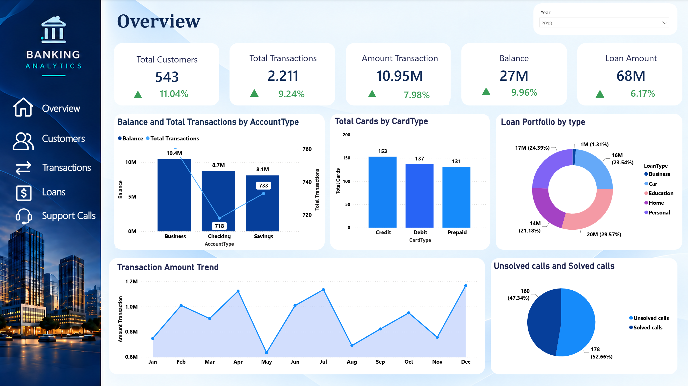
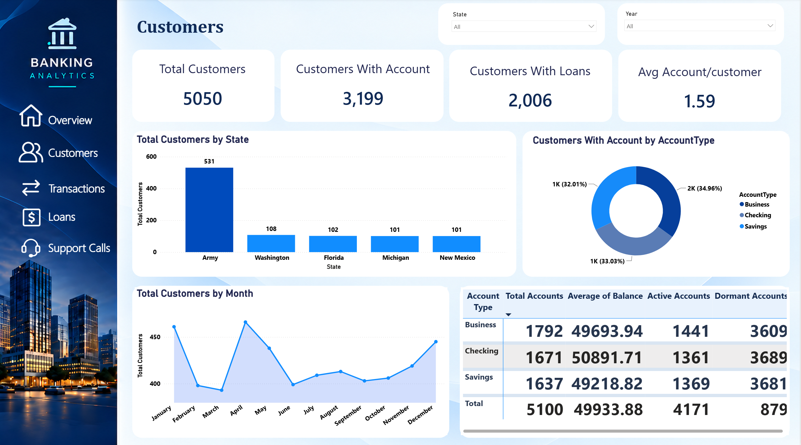
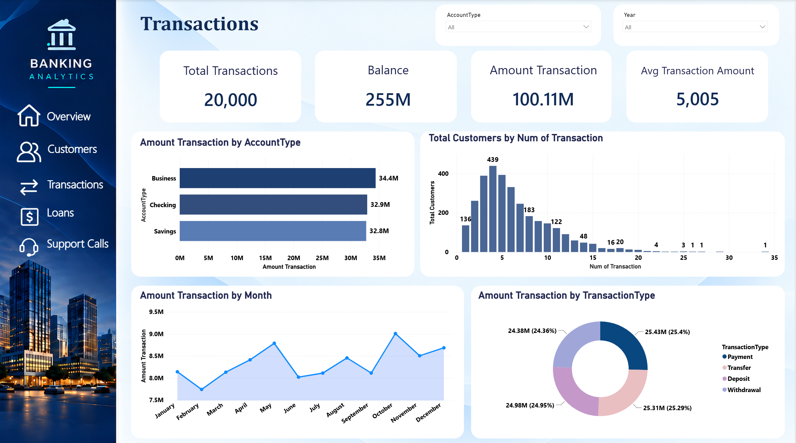
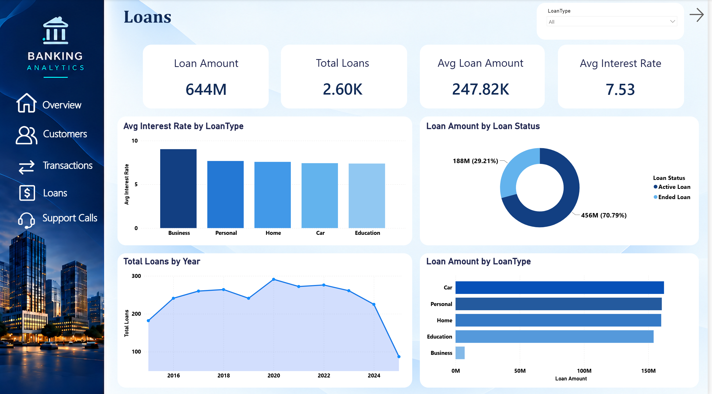

# 🏦 Banking Data Analytics Dashboard

**Banking Data Analytics Dashboard** is an interactive Business Intelligence solution developed using Microsoft Power BI to analyze banking operations, customer behavior, financial transactions, loan performance, and customer service activities.

The project transforms raw banking data into meaningful business insights through interactive dashboards, enabling stakeholders to monitor key performance indicators, evaluate financial performance, understand customer behavior, and identify opportunities to improve operational efficiency and business growth.

---

## 🎯 Project Objective

The primary objective of this project is to develop a comprehensive banking analytics solution that enables financial institutions to:

- Monitor overall banking performance and financial activities.
- Analyze customer demographics and customer segmentation.
- Track financial transactions and transaction patterns.
- Evaluate loan distribution and lending performance.
- Track loan start dates, end dates, and loan statuses.
- Analyze customer service activities and support calls.
- Monitor key financial and operational performance indicators.
- Identify customer behavior patterns and business trends.
- Support data-driven decision-making and strategic planning.

---

## 📌 Key Performance Indicators

The dashboard provides an overview of important banking performance metrics, including:

- 💰 Total Transaction Amount
- 🔢 Total Number of Transactions
- 👥 Total Customers
- 🏦 Total Loans
- 📊 Average Transaction Value
- 📈 Loan Performance
- 📅 Loan Start & End Date Tracking
- 📞 Total Support Calls
- 👤 Customer Activity

---

## 🔍 Key Insights

### Transactions Analysis
Analyzes transaction volumes, transaction values, financial activity patterns, and trends to understand banking transaction performance.

### Customer Analysis
Provides insights into customer demographics, customer distribution, segmentation, and behavioral patterns to better understand the customer base.

### Loan Analysis & Tracking
Evaluates loan distribution, lending activities, interest rates, loan types, loan amounts, start dates, end dates, and current loan statuses.

### Customer Support Analysis
Examines customer support calls, service activity, and support trends to identify potential areas for improving customer experience.

### Overall Banking Performance
Combines financial, customer, lending, and operational insights to provide a comprehensive view of banking activities.

---

## 📊 Dashboard Preview

### Page 1 — Banking Overview

### Page 2 — Customer Analysis

### Page 3 — Transactions Analysis

### Page 4 — Loan Analysis

### Page 5 — Customer Support Analysis

---

## 📁 Project Files

| File | Description |
|---|---|
| [Banking_Dataset.zip](Banking_Dataset.zip) | Banking Dataset |
| [Banking_Dashboard.pbix](Banking_Dashboard.pbix) |Interactive Power BI Dashboard |
| [Overview.png](Overview.png) | Banking Overview Dashboard |
| [Customers.png](Customers.png) | Customers Dashboard |
| [Transactions.png](Transactions.png) | Transactions Dashboard |
| [Loans.png](Loans.png) | Loans Dashboard |
| [Loans.png](Tracking%20LoanStartDate%20&%20LoanEndDate.png) | Loans Tracking |
| [Support Calls.png](Support%20Calls.png) | Support Calls Dashboard |

---

## 🛠️ Tools & Technologies

- Microsoft Power BI
- Power Query
- DAX (Data Analysis Expressions)
- Data Cleaning & Transformation
- Data Modeling
- Data Visualization
- Business Intelligence & Analytics

---

## 📈 Dashboard Features

The Banking Data Analytics Dashboard consists of five interactive pages, each designed to analyze a specific aspect of banking operations and provide meaningful business insights.

### 1. Banking Overview

Provides a comprehensive summary of overall banking performance through key financial and operational indicators.

**Key Performance Indicators (KPIs):**
- Total Customers
- Total Transactions
- Transaction Amount
- Total Balance
- Loan Amount

**Visualizations & Analysis:**
- Balance and Total Transactions by Account Type.
- Total Cards by Card Type (Credit, Debit, and Prepaid).
- Loan Portfolio Distribution by Loan Type.
- Monthly Transaction Amount Trends.
- Solved vs. Unsolved Customer Support Calls.

**Interactive Filters:**
- Year

### 2. Customers Analysis

Focuses on customer demographics, account ownership, customer distribution, and banking relationships.

**Key Performance Indicators (KPIs):**
- Total Customers
- Customers with Accounts
- Customers with Loans
- Average Accounts per Customer

**Visualizations & Analysis:**
- Total Customers by State.
- Customers with Accounts by Account Type.
- Monthly Customer Distribution.
- Account Performance Summary by Account Type, including:
  - Total Accounts
  - Average Balance
  - Active Accounts
  - Dormant Accounts

**Interactive Filters:**
- State
- Year

### 3. Transactions Analysis

Provides insights into financial transaction activities, transaction values, account types, and monthly transaction patterns.

**Key Performance Indicators (KPIs):**
- Total Transactions
- Total Balance
- Total Transaction Amount
- Average Transaction Amount

**Visualizations & Analysis:**
- Transaction Amount by Account Type.
- Customer Distribution by Number of Transactions.
- Monthly Transaction Amount Trends.
- Transaction Amount Distribution by Transaction Type:
  - Payments
  - Transfers
  - Deposits
  - Withdrawals

**Interactive Filters:**
- Account Type
- Year

### 4. Loans Analysis & Tracking

Evaluates loan portfolio performance, lending activities, interest rates, loan distribution, and individual loan lifecycle tracking.

**Key Performance Indicators (KPIs):**
- Total Loan Amount
- Total Loans
- Average Loan Amount
- Average Interest Rate

**Visualizations & Analysis:**

**Loan Portfolio Analysis:**
- Average Interest Rate by Loan Type.
- Loan Amount Distribution by Loan Status:
  - Active Loans
  - Ended Loans
- Total Loans by Year.
- Loan Amount by Loan Type:
  - Business
  - Personal
  - Home
  - Car
  - Education

**Loan Tracking – Loan Start Date & Loan End Date:**

Provides a detailed table for monitoring individual customer loans and tracking their lifecycle from origination to scheduled end date.

- Customer Identification: Displays Customer ID and Full Name.
- Loan Classification: Identifies the loan type for each customer.
- Loan Amount Tracking: Displays the amount assigned to each individual loan.
- Total Loans: Shows the number of loans associated with each record.
- Loan Start Date: Tracks the loan origination date, including year and month.
- Loan End Date: Tracks the scheduled loan maturity date, including day, year, and month.
- Loan Status Monitoring: Distinguishes between Active Loans and Ended Loans.

**Interactive Filters:**
- Loan Type

### 5. Customer Support Analysis

Analyzes customer service performance, support issues, resolution rates, and issue distribution across different categories and locations.

**Key Performance Indicators (KPIs):**
- Total Issues
- Solved Calls
- Unsolved Calls
- Solved Rate

**Visualizations & Analysis:**
- Total Issues by Issue Type and Resolution Status.
- Total Issues and Solved Calls by State.
- Daily Distribution of Customer Support Issues.
- Solved vs. Unsolved Issues Distribution.

**Interactive Filters:**
- Issue Type

---

## 💡 Business Value

The Banking Data Analytics Dashboard helps decision-makers:

- Monitor banking performance through interactive KPIs.
- Understand customer behavior and demographics.
- Evaluate financial transaction patterns.
- Assess loan distribution and lending activities.
- Track loan lifecycles through start dates, end dates, and loan statuses.
- Identify customer service trends.
- Discover operational improvement opportunities.
- Make informed, data-driven business decisions.

By integrating multiple areas of banking analytics into one interactive solution, the project supports better performance monitoring, improved operational efficiency, and more effective strategic decision-making.

---

## 👤 Author

**Sama Maher**

Data Analytics | Business Intelligence | Power BI | SQL | Python | Excel

[LinkedIn](https://www.linkedin.com/in/sama-maher-8440b3206/)

